# The Foundation of Trading

---
### Things we are learning

- `Trend trading` [ _Every trend breaks, we will definitely incur losses but the amount we will make will be disproportionally higher than losses_ ]
- We are learning to swing trade our spot position. We are `Long Bias`. Hence, we are not are trading 15min chart

---

## Market Structure Basic 

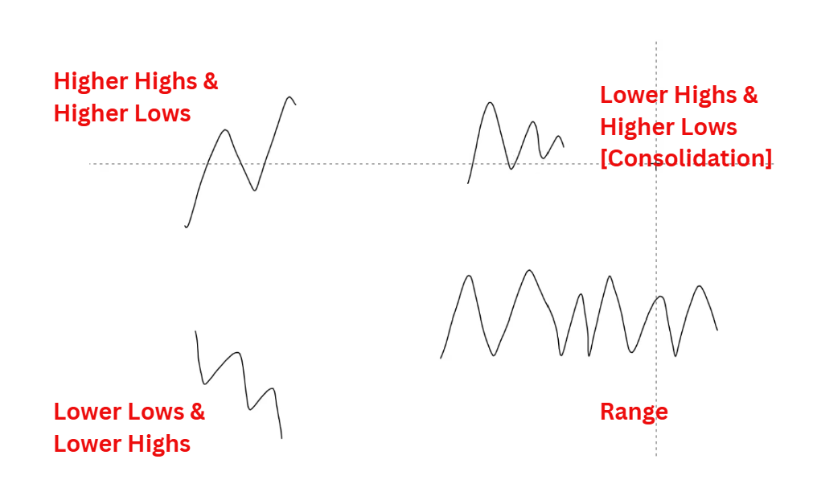

1. **Higher Highs & Higher Lows**
2. **Lower Lows & Lower Highs**
3. **Lower Highs & Higher Lows [Consolidation]**: From here either market goes up or down
4. **Range**: From here either market goes up or down

Any chart can be divided into above 4 category

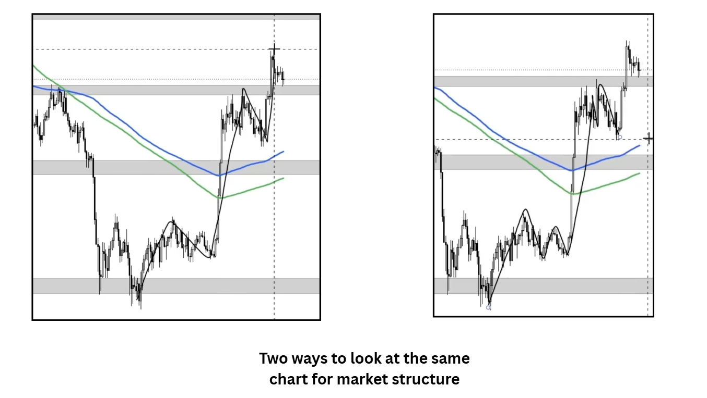

Everything is interpretive and hence anyone can have different angle. Therefore, market will always exist

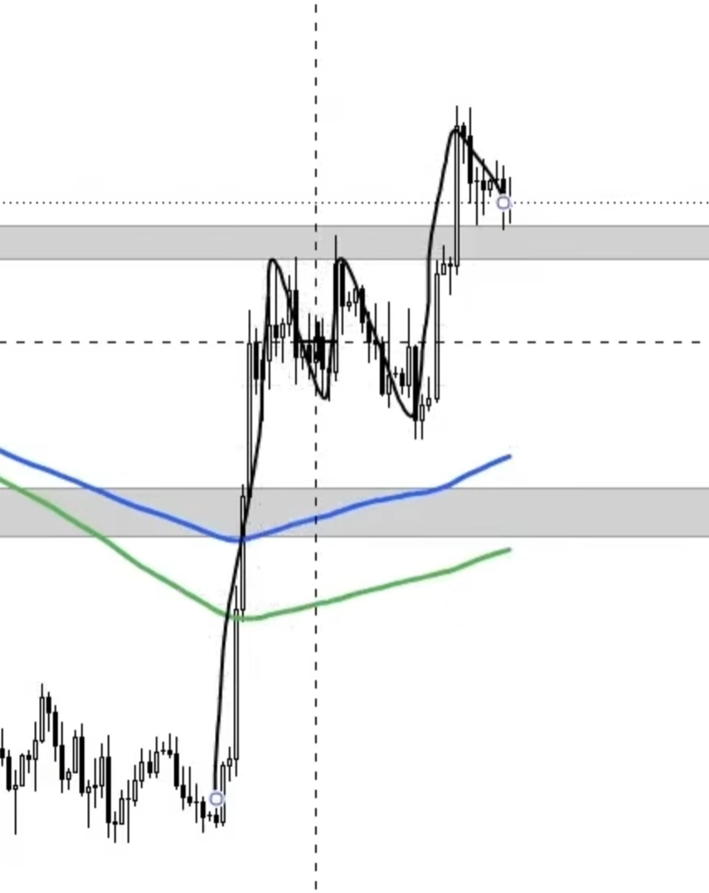
As per Mercury whatever we can see visibly on daily can be considered as current market structure

**Or we can use trick to enable `Line Chart` to see the wave**
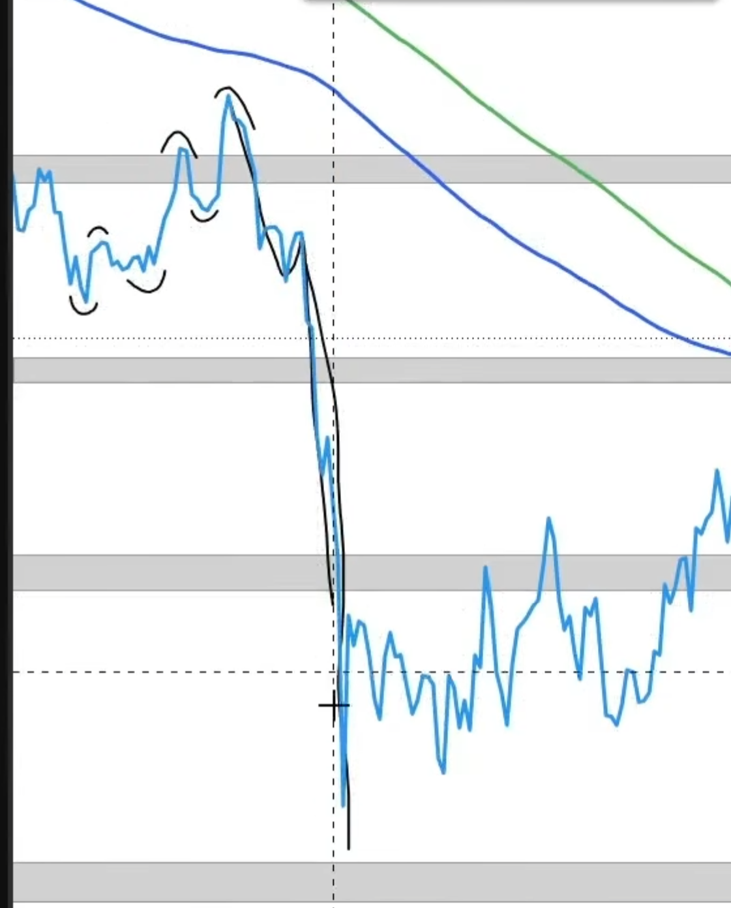

---

### Examples

1. 
- In smaller time frame below chart in uptrend but in larger time frame it is in range
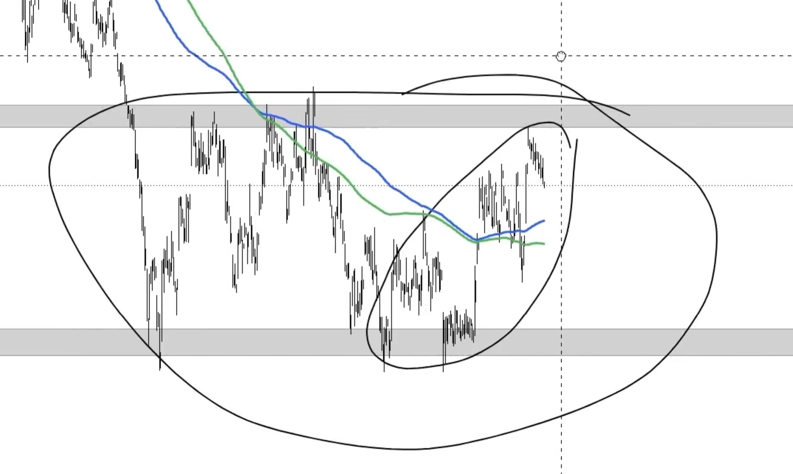

- If we zoom out then there is range within range
- Here for this chart we can say there has been no trend for 2-3 year outlook
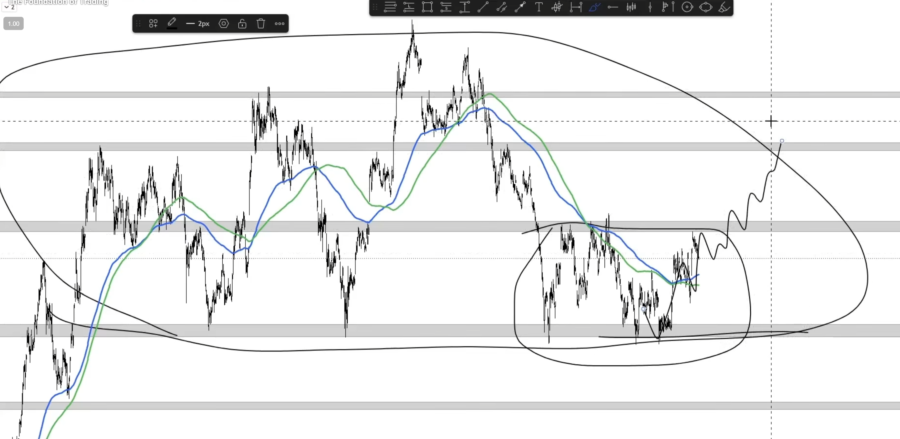

2.

- Here grey boxes are not well respected hence we might refrain from applying momentum trading strategy
- Mostly this chart is very chopy chopy
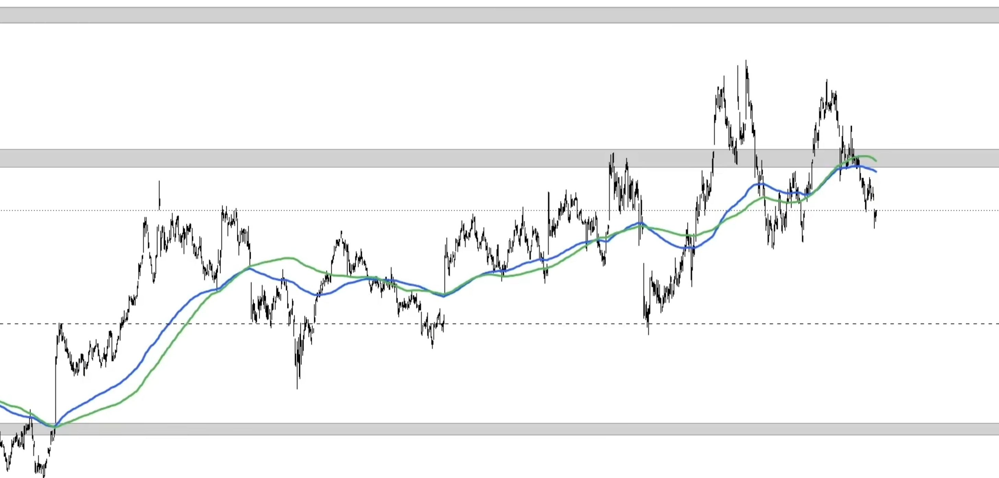

3. 
- This is chart is very bad because we are breaking from multi-year range, which is not at all good
- It is now at infancy of bearish momentum on larger time frame
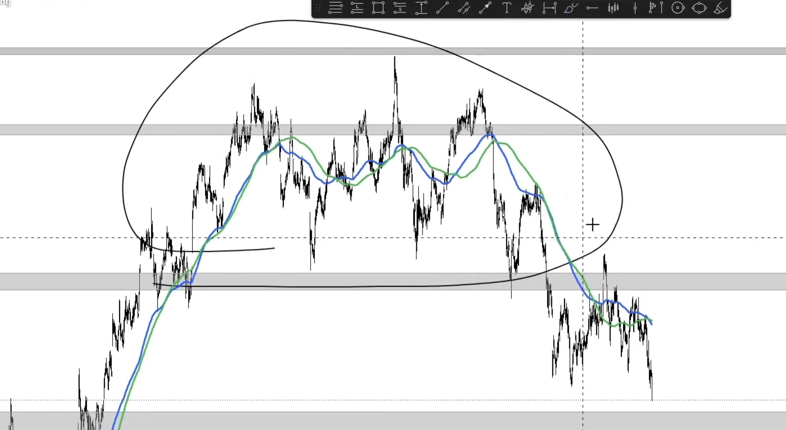

4. `HYPE`
- This chart has very favourable market structure which is `HH HL`
- Here we can start saying for new ATH
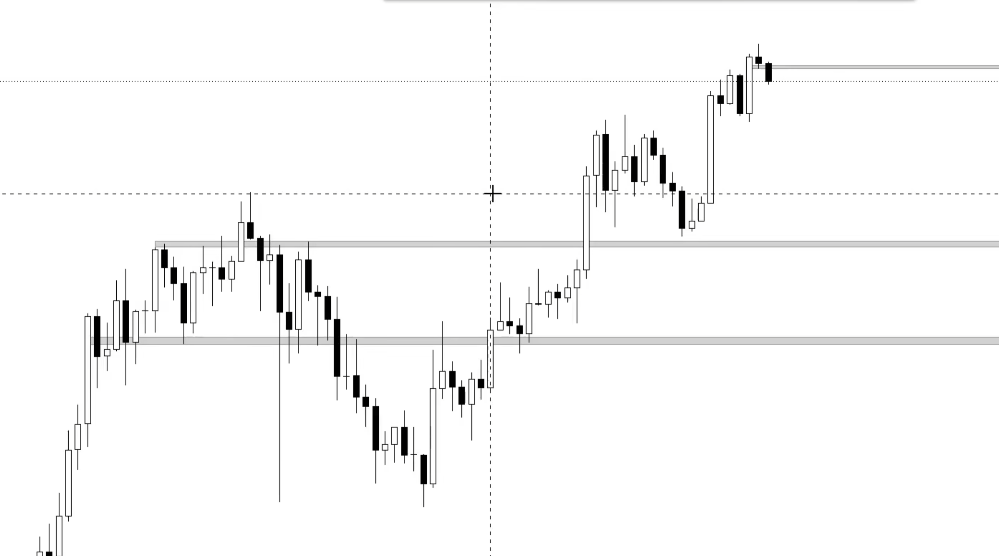

- `HYPE` vs `BTC`
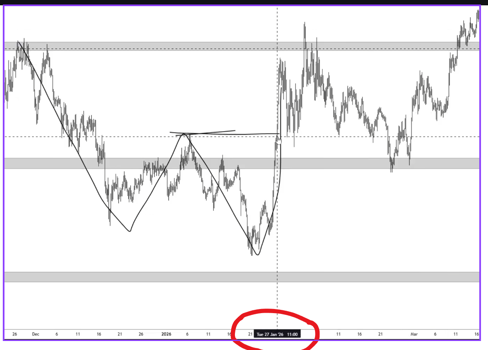
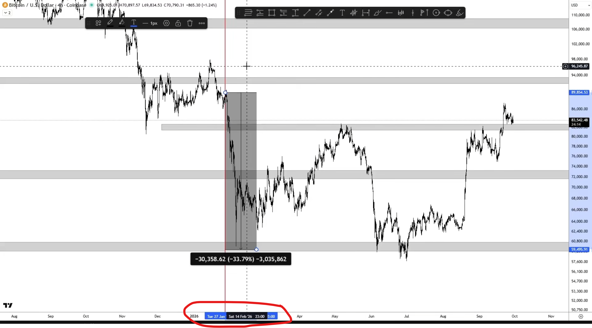

Around same time when `HYPE` is breaking out, but `BTC` is still down-trending that shows _relative strength and outperformer_

