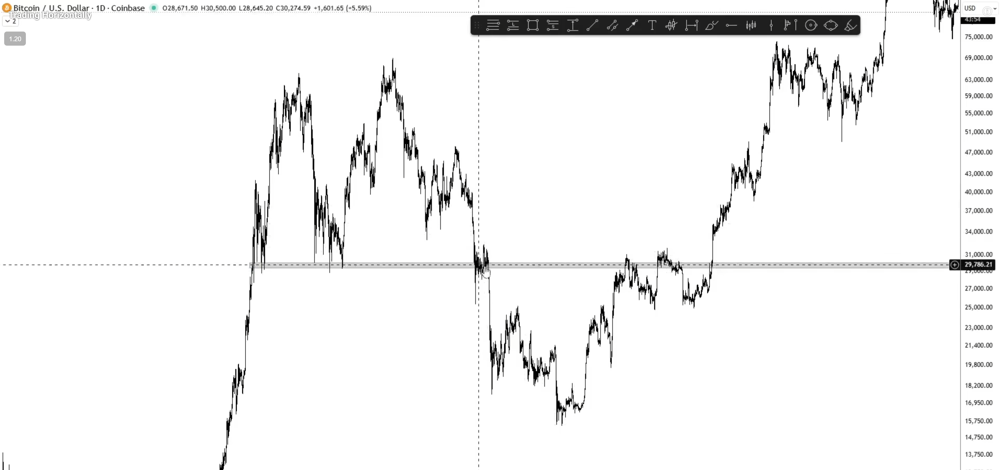
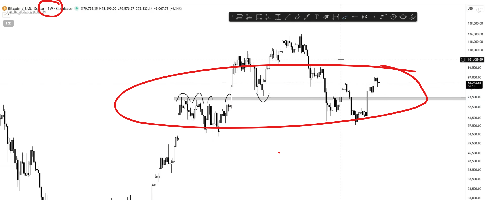
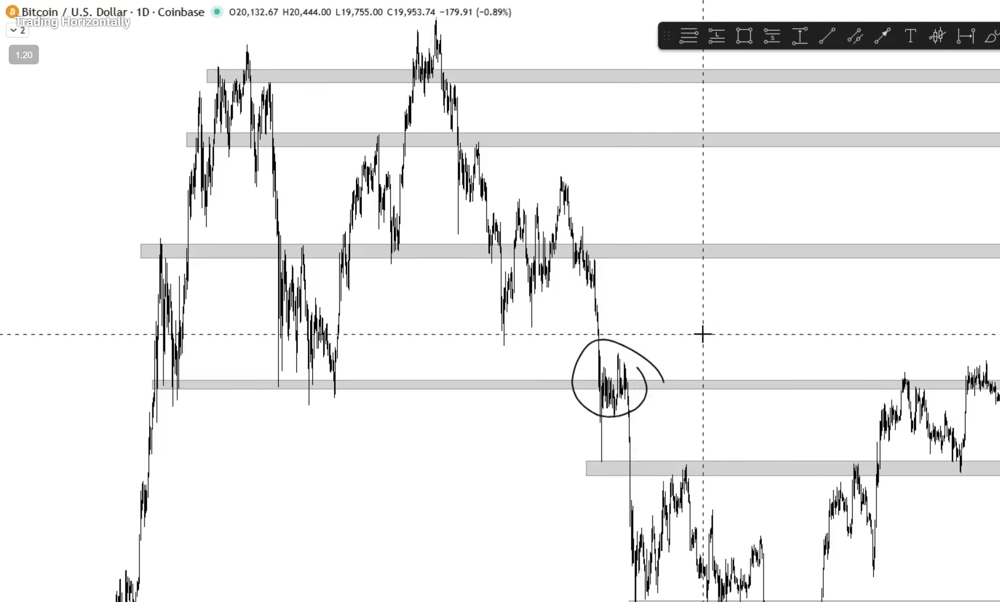
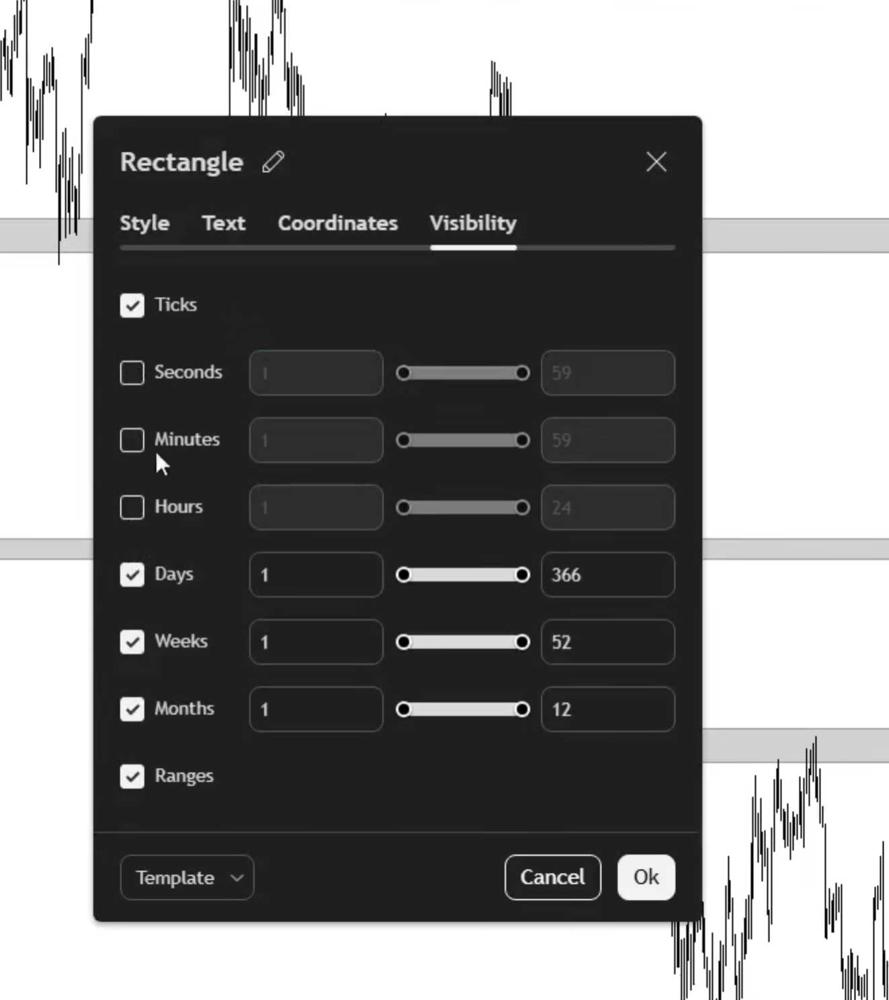
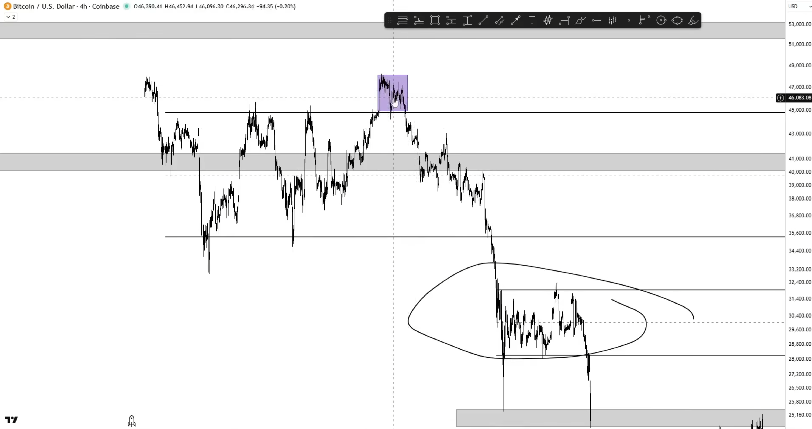

# Trading Horizontally

---
### Things we are learning

- How to draw support and resistence level

---

- These are level where people get comfortable trading
- We cannot trade vertically because we cannot draw support and resistence vertically
- We are trying to capture essence hence we won't go on drawing `lines` but `boxes` to get the essence. 

- Start from high time frame when drawing these level and slowly go inwards

- Example: Here on weekly timeframe we are able to see the reaction in weekly timeframe of resistance and support level

> **Higher** timeframe `support and resistence level` will take higher priority over **Lower** timeframe `support and resistence level`. 

For simple reason
- It took more time 
- It took more trader
- It took more volume
- It took more price action

for those region to be created

- Remove `support & resistence level` if they are not getting respected any further

- There could be situation when a level is not respected on higher time frame like below

In such situation we can do two things :-
1. From visibility remove this level for lower time frame. Such that it does not confuse us on lower time frame

2. On lower time frame you can draw range and again enable visibility for this on lower time frame only. This way you can make decision and not be indecisive for a months on certain price range

