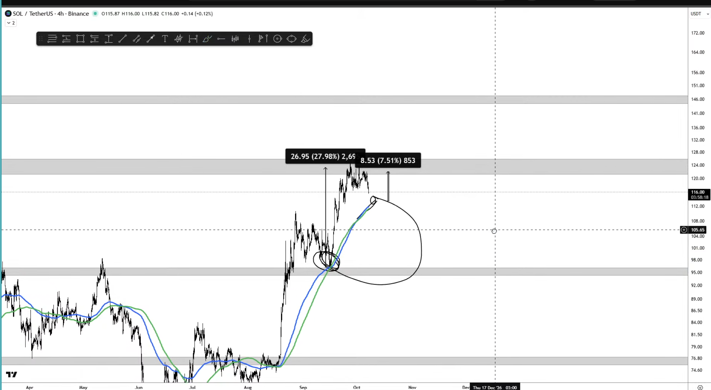

1. Do not invest too low and too much. You should feel it when you loose or win
2. Trade like it is scam. Know what you are trading
3. Moving average are just indicator, do not treat them very important. We are doing discretionary trading

## Sol Analysis

   1. 1st trade at 95 is very simple easy to execute because there is clear 27% move 
   2. But 2nd trade at 116 is not straight forward you need lot of things to happen like it need to deviate back into multi months resistance level. Lot things needs to happen for you make any profit greater than 7%...
   3. 
