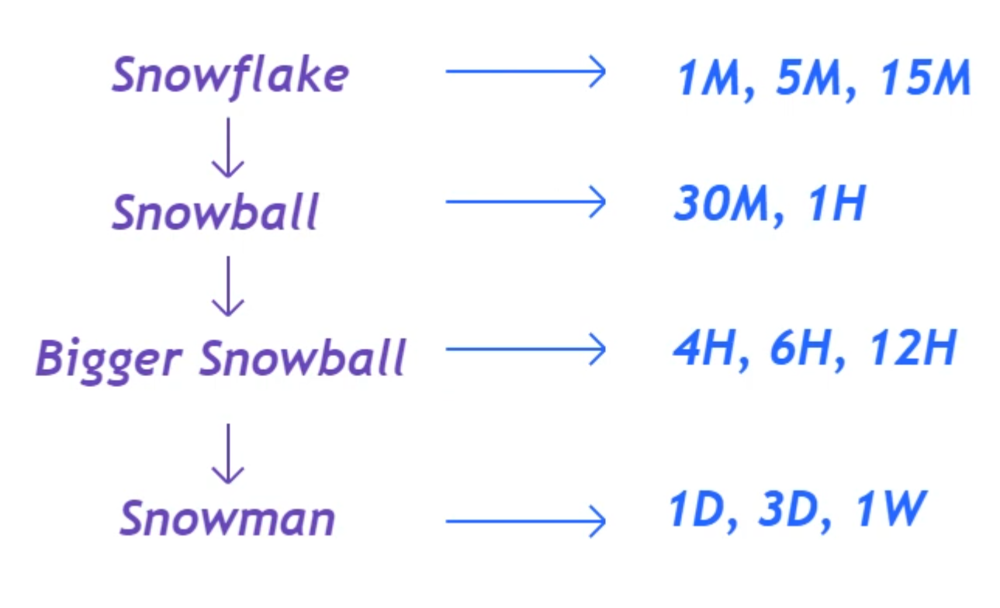
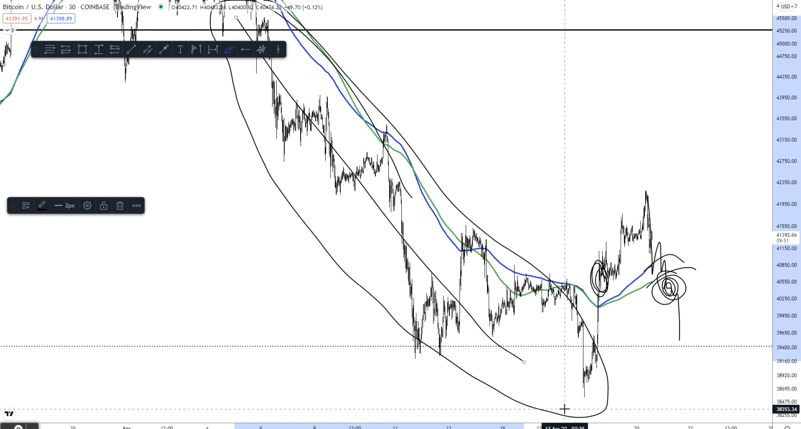

# Why price action is a snowball

---
### Things we are learning

---

- Lot of people do well trading 1min, 5min and 15min timeframe, but here we are not learning to trade those small timeframe
- At some stage all the above timeframe finally start pointing either up or down. When we can label chart to be bullish or bearish
- From ATH you will slowly start seeing weakness on lower timeframe and then slowly from snowflake it starts becoming snowball

