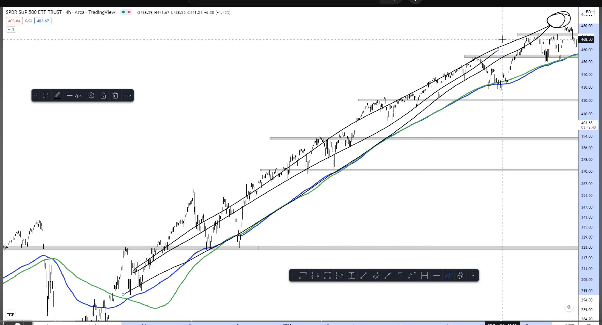
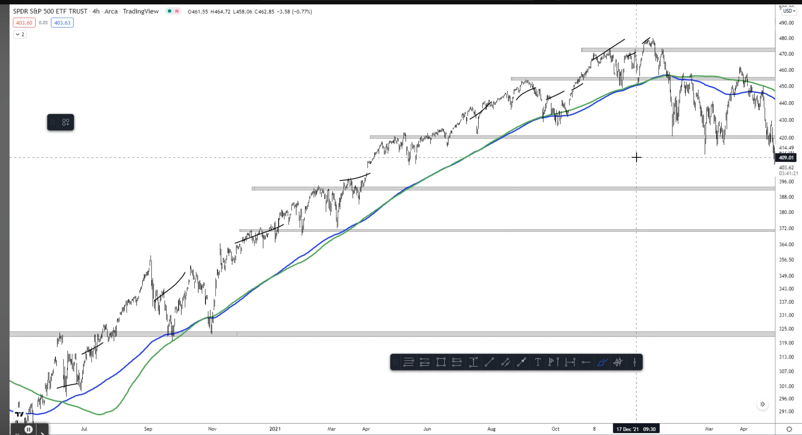
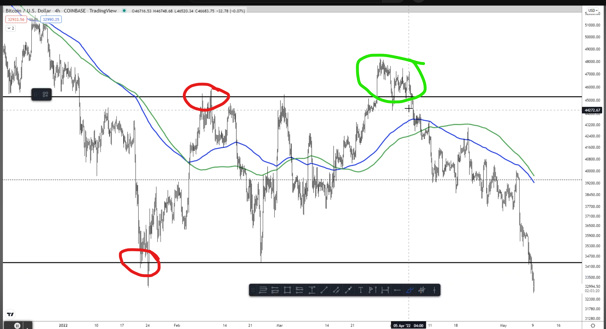
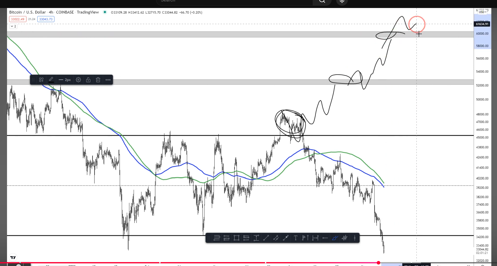
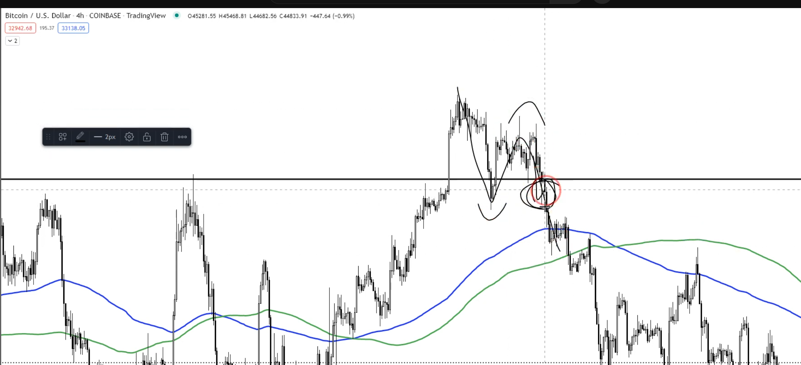

# Winners vs Losers in Markets

## Trend Trading

### Winners Mentality

- Everything is arbitrary on how you would explain we are going to top / bottom right corner
- You can come up with any reason explaining why we are going top / bottom right corner, does not really matter
- Winner mentality: How we should be thinking comes from understanding how we should not be thinking
- You could be using any sort of TA to explain why we are going top / bottom right corner, does not really matter

### Losers Mentality

- Losers keep giving reason why this is the top and even though nothing has changed on the chart for very long time
- If there is small dip they will call it top, which happened multiple time while going up. Finally one day they will be right

> **Whole point here to be a good trader you should be able to tell me if we are going to TOP / BOTTOM RIGHT CORNER when we are in a TREND**

---

## Range Trading

### Losers Mentality

- In above red marked region a loser will call it bearish and bullish respectively only proven wrong when it deviates back into the range
- Finally in green marked zone they will again call it bearish and it turn out to be bearish and they would give more credit to themselves that they did this on their own but not that they were lucky and their system does not work for most of the time

### Winner Mentality

- A winner mentality will call a range to be range and not fight against 
- In green marked zone when we break the range, winner won't hesitate to bet again because chart did something different after long-long time. Even if we deviate back into range winner won't question its system because winner analysis is objective not emotional or trying to guess things but just follow the system and execute of it

- Getting into the green marked zone, give us reason to do all other things after that in above chart. But other bullish things to happen it first need to come out long months of range price action

- You flipped bearish again when you deviate back into the range
- Definitely you would lose negative 6% but winning chance was highest when it broke out of month-long range

- Winner do not pray to be right but adapt and be ready with next plan when things go wrong
