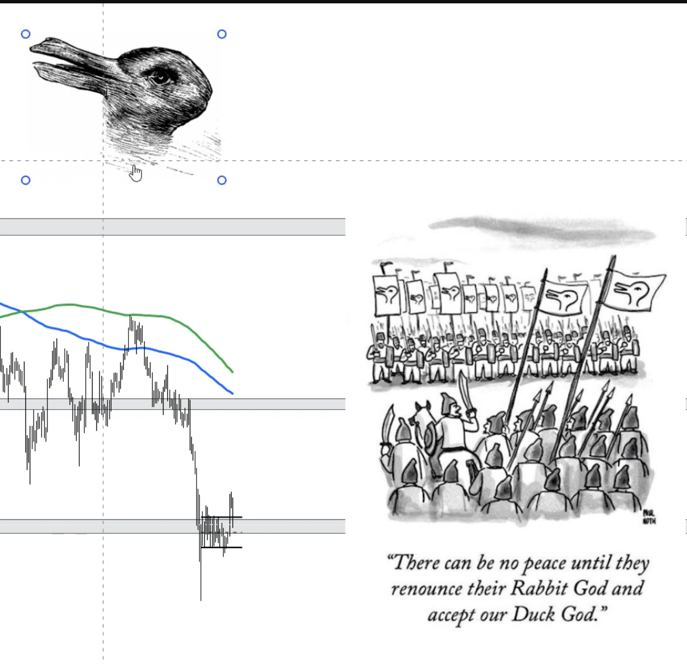
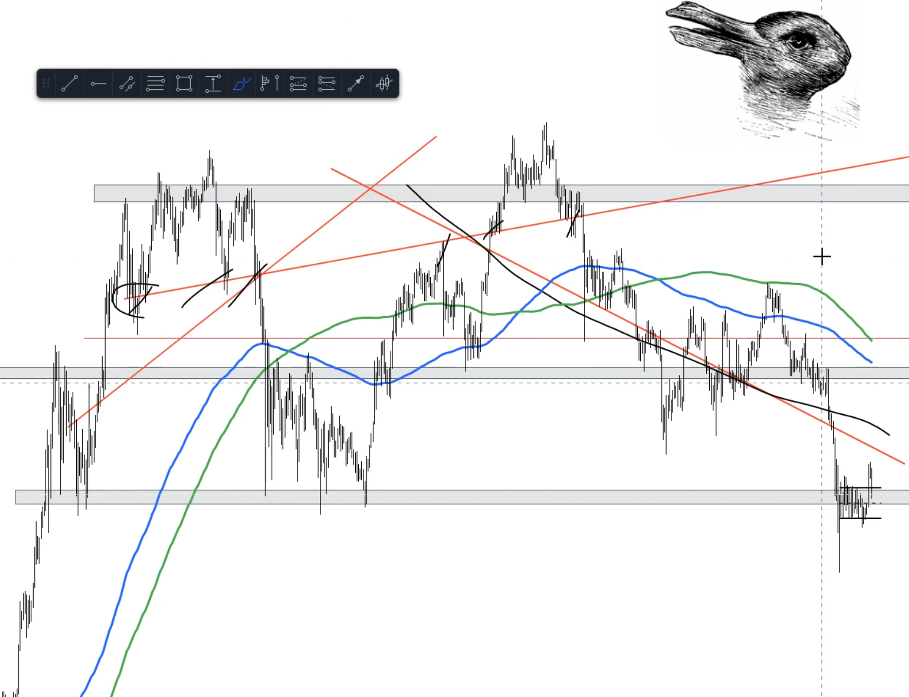
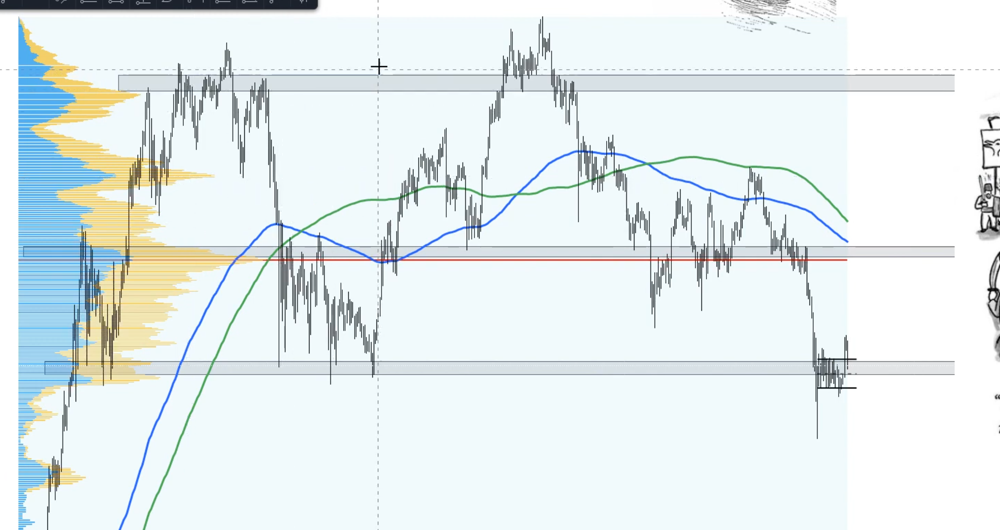

# Speculation vs. Interpretation in Markets

Referred Video: https://www.youtube.com/watch?v=FDUlrmXFCrU&list=PLVQodMIRe8mmOcaJXokzvxKPL5EByj0D1&index=10

---

1. Below are some randomly drawn lines and in each line we can make certain **speculation** and treats as pure alpha

2. Below drawn grey boxes are also **speculation** 

3. Volume, RSI etc data are **interpreted** data. Each one of us can interpret differently given a same data. It is very similar to above image of rabbit and duck. Everyone does not agree to same one animal in image. Therefore, there will be always market even all AI agent will also interpret things differently. AI is just an attempt to make replica of human brain

> It does not really matter what you speculate and interpret. What matters is that you are able to interpret and come up with some speculation to back your interpretation, you will be fallen to the right side of the market because you were able to says that given image can either duck or rabbit. Once you start doing this then you would develop a system (Process, that works)

Mercury for his system uses market structure and moving averages

 
